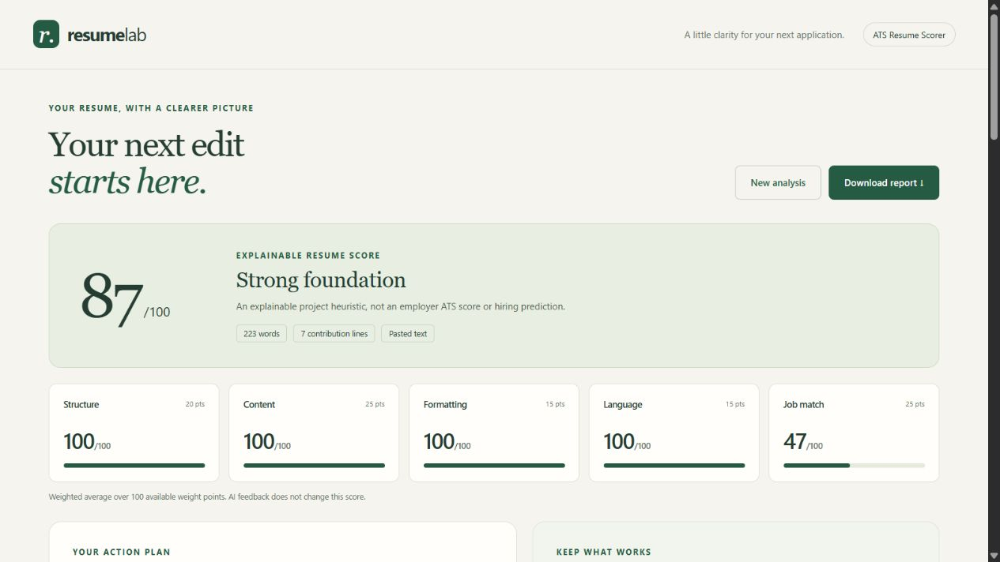

# ATS Resume Scorer

A beginner-friendly Python and Flask project that reads a resume, checks its structure and writing, compares it with a job description, and explains its scores. Optional Generative AI adds semantic skill evidence and writing suggestions.

**Start here:** run the app, try the fictional example, then follow [LEARN_STEP_BY_STEP.md](LEARN_STEP_BY_STEP.md) to rebuild it yourself. You do not need an API key for the local features.



**Project links:** [Live demo](http://127.0.0.1:5000) | GitHub repository: add the public repository URL after pushing this folder to GitHub.

## What you get

- PDF, DOCX and UTF-8 TXT uploads, or pasted resume text.
- Recognizable-section, contact-detail, action-verb and quantified-achievement checks.
- Basic English typo, repeated-word, phrasing and long-line diagnostics.
- Skill aliases, missing job skills and TF-IDF text similarity.
- Transparent category scores, strengths and actionable recommendations.
- Optional AI semantic skill checks with quotes from the supplied documents, grammar suggestions and bullet rewrites.
- Downloadable TXT and JSON reports, plus browser Print / Save as PDF.
- A responsive interface, three fictional sample inputs and automated tests.

No database, frontend framework, Java, model downloads or GPU is required. The application does not train an AI model.

## 1. Install and run

Use **Python 3.12** for the closest match to the tested environment. Install Python from [python.org](https://www.python.org/downloads/) if it is missing. On Windows, enable the installer option to add Python to PATH. Internet access is needed to install packages. After installation, local analysis works offline.

Extract the ZIP first. Open a terminal inside the extracted `ats-resume-scorer` folder, where `app.py` is located.

### Windows: quick option

Double-click `run_windows.bat`. It creates a virtual environment if needed, installs the dependencies and starts the local app. Keep its window open. Then visit **http://127.0.0.1:5000** in your browser. Press Ctrl+C in the window to stop it.

### Windows: learn the commands

```powershell
py -3 -m venv .venv
.\.venv\Scripts\python.exe -m pip install -r requirements.txt
.\.venv\Scripts\python.exe app.py
```

If `py` is unavailable but `python --version` works, replace the first command with `python -m venv .venv`. These commands do not require activating the environment, so PowerShell execution-policy changes are unnecessary.

### macOS / Linux

```bash
python3 -m venv .venv
.venv/bin/python -m pip install -r requirements.txt
.venv/bin/python app.py
```

Visit **http://127.0.0.1:5000**. On Linux, you may need your distribution's Python venv package if environment creation fails.

### Deploy on Render

The included `render.yaml` configures a free Render web service with Gunicorn. Push this project to GitHub, create a new Render Blueprint from the repository, and select the free instance plan. Render will install the dependencies, start the Flask app, and use `/` as its health check. Replace the local Live demo link above with the Render URL once deployment completes.

## 2. Try it

1. Click **Try a fictional example**. This fills the resume and job-description boxes.
2. Leave the AI checkbox off and click **Analyze my resume**.
3. Open **What we checked** to inspect the reasons behind each category.
4. Review the matched and missing skills. The sample intentionally lacks some job skills.
5. Download the text report or use **Print / Save as PDF**. Printing expands the detailed checks and includes the resume text preview.
6. Start another analysis using `samples/weak_resume.txt`. Compare the findings.
7. Use your own document and check the extracted text before trusting its report.

Use either a file or pasted resume text, not both. The file limit is 5 MB, the PDF page limit is 10, the extracted/pasted resume limit is 30,000 characters, and the job-description limit is 15,000 characters. At least 20 resume words are required.

## 3. Optional AI setup

The numerical scoring works locally. AI review is an additional feature, enabled separately for each analysis.

1. Copy `.env.example` to `.env` in the same folder as `app.py`.
2. Add your own OpenAI API key and a supported model available to your account:

```dotenv
OPENAI_API_KEY=your_actual_api_key
OPENAI_MODEL=gpt-4o-mini
```

3. Restart the app.
4. Check **Add an AI second opinion** before submitting.

That checkbox authorizes sending the **full resume text and job description** to OpenAI. API usage may incur charges. Never commit `.env` or put an API key into HTML or JavaScript. `.gitignore` already excludes `.env`.

The implementation uses the Responses API with a structured Pydantic output, `store=False`, a timeout and no automatic retries. The supported model is configurable. See the [official Structured Outputs guide](https://developers.openai.com/api/docs/guides/structured-outputs?api-mode=responses) for the API format and its limitations.

If a key is missing, the request fails, or the model declines/incompletely returns a review, the local report remains available. Quoted evidence is checked against the inputs; suggestions that introduce new numeric values are discarded. These checks do not prove that an AI interpretation or rewrite is correct. Review all generated content before using it.

## Project map

```text
ats-resume-scorer/
  app.py                    Flask routes: input -> analysis -> HTML
  parser.py                 PDF / DOCX / TXT -> plain text
  data.py                   Skill aliases, section names, verbs and typos
  analyzer.py               Local NLP, checks and scoring
  ai_review.py              Optional Generative AI and quote validation
  reports.py                Report dictionary -> readable TXT
  templates/
    base.html               Shared page shell
    index.html              Resume form
    report.html             Report display
  static/
    style.css               Layout and visual design
    app.js                  Form hints, downloads and printing
  samples/                  Fictional examples and a sample report
  tests/test_project.py     Automated checks, including mocked AI responses
  README.md                 Setup and usage
  LEARN_STEP_BY_STEP.md      Rebuild the project in small stages
  SCORING_AND_LIMITATIONS.md Exact scoring rules and practical limits
  TESTING.md                What was verified and how to rerun it
  requirements.txt          Compatible dependency ranges
  requirements-tested.txt   Exact versions used for this delivery
  .env.example              Optional AI configuration template
  .gitignore                Excludes secrets and generated files
  run_windows.bat           Convenience launcher
```

Use the normal `requirements.txt` for installation. The tested snapshot is also available with `pip install -r requirements-tested.txt` when you want the exact versions used here. Python packages are installed separately; the ZIP does not include a virtual environment.

## Run the tests

```powershell
.\.venv\Scripts\python.exe -m unittest discover -s tests -v
```

On macOS/Linux, replace the executable with `.venv/bin/python`. Tests use fictional text and mocked API responses. They do not make paid API calls.

GitHub Actions runs the same test suite and `pip check` on every push and pull request using Python 3.12. The workflow is defined in `.github/workflows/tests.yml`.

## What this project does not claim

The score is a **transparent educational heuristic**, not an employer's ATS score, probability of selection or validated hiring prediction. A high score can still describe a weak resume. Keyword mentions do not prove skill, and the local dictionary cannot understand negation or distinguish required from preferred skills.

Local TF-IDF compares wording; semantic interpretation belongs to the optional AI feature. Basic local language checks are not a full grammar engine. PDF/DOCX extraction is not visual-layout analysis. Scanned images need OCR in another tool first. Read [SCORING_AND_LIMITATIONS.md](SCORING_AND_LIMITATIONS.md) for details.

This is a local learning application. It binds to your own computer with debugging off. It has no accounts, database or saved-upload directory. Do not expose the development server publicly. A public deployment needs authentication, rate limiting, durable secret configuration and isolated document processing. Framework or operating-system temporary upload handling may still occur; no claim of secure memory erasure is made.

## Troubleshooting

| Problem | What to do |
| --- | --- |
| Python command is missing | Install Python, reopen the terminal, and check `py --version` or `python --version`. |
| A package cannot be imported | Use the `.venv` Python for both installation and running. |
| Port 5000 is already in use | Stop your other copy of the app, or change `port=5000` at the bottom of `app.py` to `5001`. |
| The resume appears empty | Check whether it is a scanned PDF. Paste text or export a text-based PDF instead. |
| Contact details are missing from DOCX | Move them from a header/text box into the document body. |
| The AI checkbox is disabled | Save a non-empty API key in `.env`, next to `app.py`, then restart. |
| AI review is unavailable | Check model access, the API key, billing and connectivity. The local report still works. |
| A section was not detected | Use a heading from `SECTIONS` in `data.py`, or add your preferred heading. |
| A valid skill was missed | Add it and its aliases to `SKILLS` in `data.py`. |
| The score looks too high or low | Inspect the exact checks. The thresholds are editable project decisions. |

## Learn from primary documentation

- [Flask quickstart](https://flask.palletsprojects.com/en/stable/quickstart/) for routes and templates.
- [Flask file uploads](https://flask.palletsprojects.com/en/stable/patterns/fileuploads/) for upload handling and request limits.
- [pypdf extraction](https://pypdf.readthedocs.io/en/stable/user/extract-text.html) for PDF text extraction and its limits.
- [TF-IDF vectorizer](https://scikit-learn.org/stable/modules/generated/sklearn.feature_extraction.text.TfidfVectorizer.html) for converting text to weighted features.
- [OpenAI Structured Outputs](https://developers.openai.com/api/docs/guides/structured-outputs?api-mode=responses) for structured AI responses.
